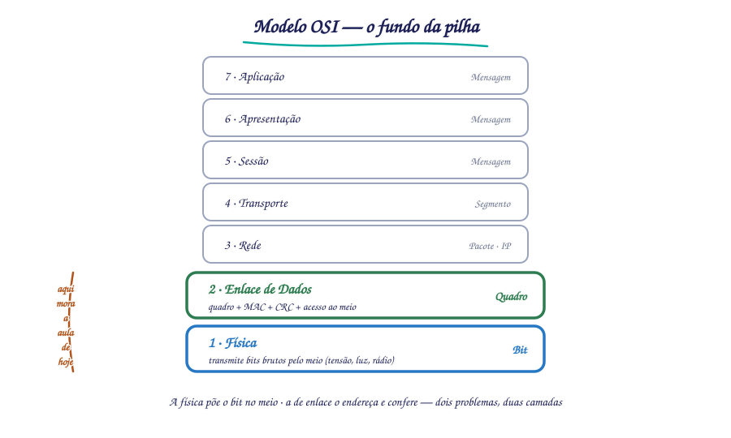
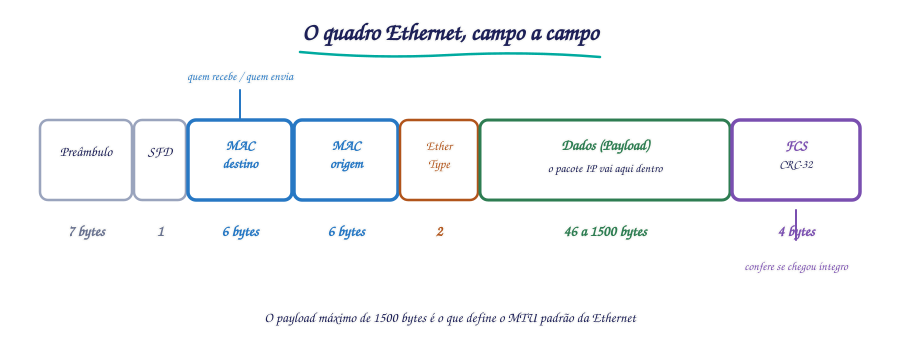
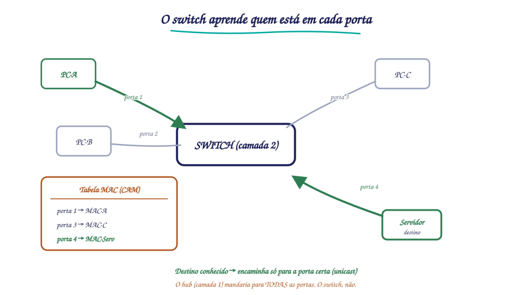

# 🔌 Aula 04 — Camada Física, Camada de Enlace e Ethernet

**Disciplina:** {{CODIGO}} — Redes de Computadores I · Sistemas de Informação — Uniube 
**Professor:** Romualdo Mathias Filho · **romualdo.filho@uniube.br** 
**Período:** {{PERIODO}} · 📘 Teórica (75 min) 
**Página de referência:** [Plano de Ensino e Contrato](./Plano-de-Ensino-e-Contrato)

---

<b>Nosso caminho até aqui</b>

Responda **antes** de abrir. Se errar, você acabou de descobrir o que revisar hoje. Tudo isto veio das Aulas 02 e 03 — é o chão sobre o qual a aula de hoje se apoia.

Numa rede em estrela ligada a um HUB, por que todos os hosts ainda sofriam colisão, como num barramento?

Porque o hub é um dispositivo de **camada 1**: ele só repete o sinal elétrico em todas as portas, sem entender endereço nenhum. A estrela era física; logicamente, todos ouviam todos e colidiam como num cabo único. Hoje você vê **quem** resolveu isso — o switch — e **como** ele faz, sozinho.

O cabo par trançado "trança" os fios por quê, exatamente?

Para cancelar a **diafonia** (*crosstalk*) e o ruído eletromagnético externo. O trançamento faz os pares vizinhos se interferirem de forma oposta, anulando o ruído. É um truque da **camada física** — a camada que hoje abrimos por dentro.

Qual é a diferença de papel entre o endereço que identifica a máquina na LAN e o endereço que a leva a outra rede?

Um é local, o outro é global. O endereço **local** (que você conhece hoje como MAC) só vale dentro da LAN; o **lógico/roteável** (o IP, camada 3) leva o pacote entre redes. A aula de hoje é sobre o primeiro — e sobre por que ele não basta sozinho para a Internet funcionar.

> [!INFO] 🎯 O que você leva desta aula
> - O que faz a **camada física** (camada 1) e a **camada de enlace** (camada 2), e por que elas são duas e não uma.
> - O que é um endereço **MAC** (Media Access Control), como ele se estrutura e por que ele **não substitui** o IP.
> - A anatomia do **quadro Ethernet** campo a campo, e como o **switch** aprende sozinho quem está em cada porta.
> - A diferença entre **CSMA/CD** (cabo) e **CSMA/CA** (sem fio) — duas respostas para o mesmo problema: quem fala agora?
>
> **📂 Recursos**
> - [Plano de Ensino e Contrato](./Plano-de-Ensino-e-Contrato) — calendário, notas, prazos e regras.
> - [macvendors.com](https://macvendors.com/) — consulta o fabricante pelo OUI do MAC (prática de hoje).

---

## 📌 1. Por que duas camadas no fundo da pilha [Fundamentação ⏳ 10 min]

Antes de qualquer tabela, a pergunta que justifica a aula: **por que o modelo OSI separa o "fundo" da rede em duas camadas** — física e enlace — em vez de uma só?

Pense no que é preciso para um bit sair do seu computador e chegar ao switch ao lado. Primeiro, alguém tem de transformar o bit num **sinal físico** — uma variação de tensão no cobre, um pulso de luz na fibra, uma onda de rádio no ar. Esse é um problema de engenharia elétrica: voltagem, frequência, conector, distância. É a **camada física** (camada 1).

Mas um sinal solto não chega a lugar nenhum útil. Ele precisa estar **endereçado** — "este quadro é para a placa de rede tal" — e **verificado** — "chegou inteiro ou corrompeu no caminho?". Esse é um problema de organização, não de eletricidade: empacotar os bits em **quadros** (*frames*), colocar um endereço local, conferir a integridade. É a **camada de enlace** (camada 2).

São dois problemas de natureza diferente, e por isso duas camadas. A camada física não sabe o que é um endereço; a camada de enlace não sabe o que é um volt. Essa separação é o que permite trocar o **meio** (de cabo para fibra) sem reescrever o **enquadramento**, e vice-versa.

<figure class="au-fig">

<figcaption class="au-legenda">Figura 1: a pilha OSI com as camadas 1 (Física) e 2 (Enlace) destacadas — a fronteira entre o sinal bruto e o quadro endereçado.</figcaption>
</figure>

> [!NOTE] 📖 Onde isso mora na pilha OSI
> O modelo OSI (Open Systems Interconnection), padronizado pela ISO (International Organization for Standardization) em 1984, divide a comunicação em **sete camadas**. Hoje olhamos as duas de baixo; nas próximas aulas subimos até a de rede (camada 3, o IP) e a de transporte (camada 4, TCP e UDP).

| Camada | Nome | Unidade de dados | Função principal |
| :-- | :-- | :-- | :-- |
| 7 | Aplicação | Mensagem | Interface com o usuário (HTTP, DNS, SMTP) |
| 6 | Apresentação | Mensagem | Formatação, criptografia, compressão |
| 5 | Sessão | Mensagem | Controle de sessões e diálogos |
| 4 | Transporte | Segmento | Entrega fim a fim, confiabilidade (TCP, UDP) |
| 3 | Rede | Pacote | Endereçamento lógico e roteamento (IP) |
| **2** | **Enlace de Dados** | **Quadro (frame)** | **Entrega nó a nó, controle de erros, endereço MAC** |
| **1** | **Física** | **Bit** | **Transmissão bruta de bits pelo meio físico** |

---

## 📌 2. A camada física: o bit vira sinal [Teoria ⏳ 12 min]

A **camada física** é responsável pela transmissão de **bits brutos** (0s e 1s) através do meio. Ela define as regras elétricas, mecânicas e funcionais para ativar e manter a conexão física — mas **não entende** endereço, nem quadro, nem erro. O trabalho dela é um só: pôr o bit no meio e tirá-lo do outro lado.

| O que a camada física define | Exemplo concreto |
| :-- | :-- |
| Como o bit é representado no meio | tensão (ex.: +5 V = 1, 0 V = 0), pulso de luz, frequência de rádio |
| Especificação mecânica | formato do conector RJ-45, pinagem T568A/T568B |
| Especificação funcional | significado de cada pino (pinos 1,2 = TX, de *Transmit* / transmissão; 3,6 = RX, de *Receive* / recepção, no RJ-45) |
| Codificação de linha | Manchester, 4B/5B, 8B/10B, PAM-4 |
| Taxa de dados | medida em bps: 100 Mbps, 1 Gbps, 10 Gbps |

**Na prática, os padrões Ethernet da camada física** que você encontra no laboratório e no mercado:

| Padrão | Velocidade | Meio | Distância | Nome comum |
| :-- | :-- | :-- | :-- | :-- |
| 10BASE-T | 10 Mbps | Par trançado CAT3+ | 100 m | Ethernet |
| 100BASE-TX | 100 Mbps | Par trançado CAT5+ | 100 m | Fast Ethernet |
| 1000BASE-T | 1 Gbps | Par trançado CAT5e+ | 100 m | Gigabit Ethernet |
| 10GBASE-T | 10 Gbps | Par trançado CAT6a | 100 m | 10 Gigabit Ethernet |
| 1000BASE-SX | 1 Gbps | Fibra multimodo | 550 m | Gigabit Ethernet (fibra) |
| 10GBASE-LR | 10 Gbps | Fibra monomodo | 10 km | 10GbE Long Reach |

> [!TIP] 💡 Lendo o nome do padrão
> O nome não é decoração: em `100BASE-TX`, o **100** é a velocidade (100 Mbps), `BASE` indica transmissão em **banda base** (um sinal por vez no meio, sem modulação em portadora), e `TX` aponta o meio (par trançado de cobre). Decifrar o nome já diz velocidade, sinalização e meio de uma vez.

---

## 📌 3. A camada de enlace: o bit vira quadro endereçado [Teoria ⏳ 12 min]

A **camada de enlace** transforma o serviço bruto da camada física em comunicação **confiável entre nós adjacentes** (vizinhos diretos no mesmo meio). Ela faz quatro coisas que a física não faz:

- **Enquadramento:** organiza os bits em **quadros** com delimitadores de início e fim.
- **Endereçamento local:** acrescenta o endereço **MAC** de origem e destino.
- **Detecção de erro:** anexa um código **CRC** (Cyclic Redundancy Check) que denuncia se o quadro chegou corrompido.
- **Controle de acesso ao meio:** decide **quem transmite e quando**, para vários hosts não falarem ao mesmo tempo no mesmo meio.

O IEEE (Institute of Electrical and Electronics Engineers) divide a camada 2 em duas subcamadas, e vale saber por quê:

| Subcamada | Padrão | Função |
| :-- | :-- | :-- |
| **LLC** (Logical Link Control) | IEEE 802.2 | diz qual protocolo vem acima (o quadro carrega IPv4? IPv6? ARP, de Address Resolution Protocol?), faz controle de fluxo |
| **MAC** (Media Access Control) | definida dentro de cada padrão: IEEE 802.3 (Ethernet), 802.11 (Wi-Fi) | endereçamento físico (MAC), enquadramento, controle de acesso ao meio |

> [!NOTE] 📖 A LLC vale para os dois
> A subcamada **LLC** (802.2) é comum à Ethernet e ao Wi-Fi — ela fica acima e não depende do meio. Já a **MAC** é definida *dentro* de cada padrão de meio (802.3 para cabo, 802.11 para rádio), porque controlar o acesso ao cobre e ao ar são problemas diferentes.

> [!NOTE] 📖 Por que "nó a nó", e não "fim a fim"
> A camada de enlace só garante a entrega até o **próximo** equipamento no caminho (o switch, o roteador vizinho) — um salto de cada vez. Levar o dado de ponta a ponta, atravessando várias redes, é trabalho da camada 3 (IP) e da camada 4 (TCP). Enlace é o trecho; rede e transporte são a viagem inteira.

---

## 📌 4. O endereço MAC: a identidade de fábrica da placa [Teoria ⏳ 10 min]

O endereço **MAC** (Media Access Control) é um identificador de **48 bits** atribuído à interface de rede (NIC — Network Interface Card) pelo fabricante. Vem gravado na placa e serve para a camada 2 identificar origem e destino **dentro da rede local**.

| Característica | Detalhe |
| :-- | :-- |
| Tamanho | 48 bits (6 bytes) |
| Formato | hexadecimal separado por `:` ou `-` (ex.: `AA:BB:CC:DD:EE:FF`) |
| Primeiros 3 bytes | **OUI** (Organizationally Unique Identifier) — identifica o fabricante |
| Últimos 3 bytes | identificador do dispositivo (atribuído pelo fabricante) |
| Broadcast | `FF:FF:FF:FF:FF:FF` — vai para todos os hosts da rede local |
| Escopo | local: vale só dentro do domínio de broadcast (a LAN) |

<figure class="au-fig">

<figcaption class="au-legenda">Figura 2: o quadro Ethernet campo a campo — do preâmbulo ao FCS — com os tamanhos em bytes.</figcaption>
</figure>

### 4.1 MAC × IP: por que a Internet precisa dos dois

Antes de rolar: você leva seu notebook de casa para o campus e conecta no Wi-Fi da Uniube. O endereço MAC dele muda? E o IP?

**O MAC não muda; o IP muda.** O MAC é gravado na placa de fábrica e viaja com o aparelho para onde ele for — é a identidade local e fixa. O IP é atribuído pela rede onde você está (por DHCP — Dynamic Host Configuration Protocol —, normalmente): em casa você tinha um, no campus ganha outro. É exatamente por isso que o MAC sozinho não bastaria para a Internet — ele não diz **onde** o aparelho está, só **qual** aparelho é.

Esta é a confusão mais comum da disciplina, e vale fixar lado a lado:

| Aspecto | Endereço MAC | Endereço IP |
| :-- | :-- | :-- |
| Camada OSI | 2 (Enlace) | 3 (Rede) |
| Tamanho | 48 bits | 32 bits (IPv4) ou 128 bits (IPv6) |
| Formato | hexadecimal (`AA:BB:CC:DD:EE:FF`) | decimal pontuado (`192.168.1.10`) |
| Atribuição | fabricante (gravado na placa) | administrador ou DHCP (configurável) |
| Escopo | rede local (domínio de broadcast) | global (roteável entre redes) |
| Muda quando você troca de rede? | **não** — é fixo | **sim** — depende de onde você está |

> [!WARNING] ⚠️ O erro clássico: "se o MAC é único, para que serve o IP?"
> O MAC identifica a placa, mas **não diz onde ela está** no mundo — não tem hierarquia, não é roteável. É como o CPF de uma pessoa: único e fixo, mas não ajuda o carteiro a achar a casa dela. O IP é o **endereço residencial**: muda quando você se muda, mas é ele que leva a carta até o bairro certo. A Internet precisa dos dois — o IP leva o pacote até a rede de destino; o MAC entrega ao equipamento certo **dentro** dela.

---

## 📌 5. O quadro Ethernet, campo a campo [Teoria ⏳ 8 min]

O **quadro Ethernet** é a unidade de dados da camada 2. Ele embrulha o pacote IP vindo de cima e acrescenta cabeçalho e verificação para a entrega local (Figura 2).

| Campo | Tamanho | Função |
| :-- | :-- | :-- |
| **Preâmbulo** | 7 bytes | bits alternados (`10101010...`) para sincronizar os relógios de quem envia e quem recebe |
| **SFD** (Start Frame Delimiter) | 1 byte | marca o início efetivo do quadro (`10101011`) |
| **MAC Destino** | 6 bytes | endereço MAC de destino |
| **MAC Origem** | 6 bytes | endereço MAC de origem |
| **EtherType / Tamanho** | 2 bytes | identifica o protocolo encapsulado (`0x0800` = IPv4, `0x0806` = ARP, `0x86DD` = IPv6). O mesmo campo serve de EtherType (valor ≥ 0x0600, padrão Ethernet II) ou de comprimento (valor ≤ 1500, padrão IEEE 802.3) — o valor diz qual é |
| **Dados (Payload)** | 46 a 1500 bytes | o conteúdo útil: o pacote IP, o quadro ARP etc. |
| **FCS** (Frame Check Sequence) | 4 bytes | CRC-32 para detectar erro de transmissão |

> [!TIP] 💡 De onde vem o MTU de 1500
> O payload máximo de **1500 bytes** é o que define o **MTU** (Maximum Transmission Unit) padrão da Ethernet: um pacote IP maior que isso precisa ser fragmentado antes de caber no quadro. E há um mínimo: o quadro não pode ter menos de **64 bytes** — contando dos MACs ao FCS (MAC destino + origem + EtherType + payload + FCS; o preâmbulo e o SFD **não** entram nessa conta). Se o payload for menor que 46 bytes, a placa completa com bytes de preenchimento (*padding*) para fechar os 64.

---

## 📌 6. Quem fala agora? CSMA/CD e CSMA/CA [Teoria ⏳ 12 min]

Quando vários hosts dividem o mesmo meio, nasce um problema: **dois transmitindo ao mesmo tempo se embaralham** (colisão). Cabo e Wi-Fi resolvem isso de formas opostas — uma reage à colisão, a outra tenta evitá-la.

### 6.1 CSMA/CD — o cabo detecta a colisão

**CSMA/CD** (Carrier Sense Multiple Access with Collision Detection) foi o mecanismo original da Ethernet em meios compartilhados (barramento coaxial, hubs). A ideia: escuta antes de falar e, se colidir, para e tenta de novo.

1. **Escutar** (*Carrier Sense*): antes de transmitir, o host verifica se o meio está livre.
2. **Transmitir:** se livre, começa a enviar.
3. **Detectar colisão** (*Collision Detection*): se dois transmitem juntos, ambos percebem a colisão.
4. **Jam signal:** cada um envia um sinal curto para garantir que todos saibam da colisão.
5. **Backoff exponencial:** cada host espera um tempo **aleatório** antes de tentar de novo — o aleatório é o que impede os dois de recomeçarem no mesmo instante.

### 6.2 CSMA/CA — o sem fio evita a colisão

**CSMA/CA** (Carrier Sense Multiple Access with Collision Avoidance) é o mecanismo do Wi-Fi (IEEE 802.11). No rádio, **detectar** a colisão durante a transmissão é impraticável (o problema do *terminal oculto*: dois hosts podem não ouvir um ao outro), então o jeito é **evitar** a colisão antes dela acontecer.

1. **Escutar:** o host verifica se o meio sem fio está livre.
2. **IFS** (Interframe Space): se livre, espera um intervalo antes de transmitir.
3. **RTS/CTS** (opcional): pede reserva do meio (Request to Send) e espera a liberação (Clear to Send).
4. **Transmitir** o quadro.
5. **ACK:** o receptor confirma o recebimento. Sem ACK, o emissor assume colisão e retransmite.

| Aspecto | CSMA/CD | CSMA/CA |
| :-- | :-- | :-- |
| Meio | cabeado (Ethernet half-duplex) | sem fio (Wi-Fi) |
| Estratégia | **detecta** a colisão e retransmite | **evita** a colisão antes de transmitir |
| ACK na camada 2 | não usa | usa, obrigatório |
| Problema que resolve | acesso múltiplo ao meio compartilhado | terminal oculto no sem fio |
| Status hoje | obsoleto (switch full-duplex elimina colisão) | ativo em toda rede Wi-Fi |

> [!WARNING] ⚠️ CSMA/CD virou história, e o motivo é o switch
> Numa rede de **switches** operando em **full-duplex**, cada porta é um domínio de colisão próprio: o host transmite e recebe ao mesmo tempo, por pares de fios separados, e **não há com quem colidir**. O CSMA/CD continua no padrão por compatibilidade, mas numa LAN moderna ele simplesmente nunca dispara. É por isso que a próxima seção — o switch — é o que de fato aposentou a colisão no cabo.

---

## 📌 7. O switch: a camada 2 que aprende sozinha [Teoria ⏳ 10 min]

O **switch** é um dispositivo de camada 2 que encaminha quadros de forma inteligente, usando uma **tabela de endereços MAC** (tabela CAM — Content-Addressable Memory) para mandar cada quadro **só** à porta onde está o destino — ao contrário do hub, que repetia para todas.

A parte elegante: ninguém configura essa tabela. O switch **aprende** observando o tráfego.

| Etapa | O que o switch faz |
| :-- | :-- |
| 1 | recebe um quadro na porta X |
| 2 | **aprende:** associa o MAC de **origem** à porta X na tabela |
| 3 | consulta a tabela pelo MAC de **destino** |
| 4a | se achou: encaminha **só** pela porta correspondente (unicast) |
| 4b | se não achou: **inunda** (*flooding*) por todas as portas, menos a de origem |
| 5 | **envelhecimento:** entradas expiram após um tempo sem renovação (300 s é o padrão em switches Cisco) |

<figure class="au-fig">

<figcaption class="au-legenda">Figura 3: o switch aprende o MAC de origem a cada quadro e, no destino conhecido, encaminha só para a porta certa — em vez de inundar como o hub.</figcaption>
</figure>

### 7.1 Hub × Switch, lado a lado

| Aspecto | Hub | Switch |
| :-- | :-- | :-- |
| Camada OSI | 1 (Física) | 2 (Enlace) |
| Encaminhamento | replica para todas as portas | só para a porta de destino |
| Colisões | todas as portas num domínio de colisão | cada porta é um domínio próprio |
| Tabela MAC | não tem | aprende e consulta sozinho |
| Modo | half-duplex (CSMA/CD ativo) | full-duplex (sem colisão) |
| Status | obsoleto | padrão em toda LAN moderna |

> [!TIP] 💡 Por que o primeiro acesso a um host "novo" sempre inunda
> Se o switch acabou de ligar (tabela vazia) e o PC-A manda um quadro para o PC-C que ele nunca viu, o switch **inunda** — não tem como saber a porta ainda. Mas quando o PC-C **responde**, o switch aprende a porta dele. Daí em diante a conversa vira unicast. A inundação não é defeito: é o custo único de aprender.

---

<b>🔌 Momento interativo — vote antes de eu abrir o simulador</b>

Um switch acabou de ser ligado, com a tabela MAC **vazia**. O PC-A (porta 1) envia um quadro para o PC-C (porta 3), que ainda não respondeu nada. **O que o switch faz com esse primeiro quadro?** Vote no Plickers.

<b>Plano B — se o Plickers ou a internet do campus cair:</b> mão levantada — inunda por todas as portas menos a 1 (um dedo) ou manda só para a porta 3 (dois dedos). A resposta e o porquê vêm logo abaixo; o importante é você se comprometer com um palpite antes de ver.

<b>📋 Resumo — a folha de consulta</b>

| Conceito | O que é | Como lembrar |
|---|---|---|
| Camada Física (1) | transmite bits brutos pelo meio | bit → sinal; não entende endereço |
| Camada de Enlace (2) | quadro + MAC + CRC + acesso ao meio | bit → quadro endereçado |
| Endereço MAC | ID de 48 bits da placa, de fábrica | o "CPF" da NIC; local e fixo |
| OUI | 3 primeiros bytes do MAC | identifica o fabricante |
| Quadro Ethernet | unidade da camada 2 | preâmbulo · MACs · EtherType · payload · FCS |
| MTU | payload máximo Ethernet | 1500 bytes |
| CSMA/CD | detecta colisão (cabo) | obsoleto com switch full-duplex |
| CSMA/CA | evita colisão (Wi-Fi) | usa ACK; ativo em toda rede sem fio |
| Switch | camada 2 que aprende MAC→porta | encaminha só ao destino; inunda se não conhece |
| Flooding | inundar quando o MAC é desconhecido | custo único de aprender |
| Full-duplex | envia e recebe ao mesmo tempo | é o que aposentou a colisão no cabo |

| O erro clássico | A correção |
|---|---|
| "se o MAC é único, o IP é redundante" | não — o MAC não é roteável; o IP leva entre redes |
| "o switch repete o quadro para todos" | não — isso é o **hub**; o switch encaminha só à porta certa |
| "CSMA/CD ainda controla a LAN moderna" | não — switch full-duplex eliminou a colisão no cabo |
| "Wi-Fi detecta colisão como o cabo" | não — ele **evita** (CA), porque detectar no rádio é impraticável |

---

<b>🤔 Para pensar até a próxima aula</b>

O switch aprende o MAC de origem de <b>todo</b> quadro que passa — inclusive de um host que mentiu o próprio MAC. Se um invasor pode forjar o endereço MAC de outra máquina, o que isso permite fazer dentro de uma LAN? E por que, mesmo assim, o switch continua confiando no que lê? Traga sua hipótese — a resposta liga segurança de camada 2 ao que você verá sobre ARP na próxima aula.

<i>Não há resposta nesta página de propósito.</i>

---

## 🧩 Antes de fechar: a analogia que amarra tudo

Pense numa entrega de encomenda num prédio. A **camada física** é o caminhão: transporta a caixa pela estrada, sem saber o que há dentro. A **camada de enlace** é o porteiro do prédio: ele embala a encomenda num envelope padronizado (enquadramento), confere o nome do morador na portaria (endereço MAC), verifica se a caixa chegou intacta (CRC) e organiza a fila de entrega para dois entregadores não baterem na porta (controle de acesso ao meio). O **endereço MAC** é o nome na caixa de correio — vale só naquele prédio; o **IP** é o endereço da rua, que trouxe a encomenda até ali. E o **switch** é o porteiro que, de tanto ver quem mora em cada apartamento, decorou a lista e passou a entregar direto na porta certa, em vez de bater em todas.

---

<b>📚 O que sustenta esta aula, com página</b>

- **TANENBAUM, A. S.; FEAMSTER, N.; WETHERALL, D. J.** *Redes de Computadores.* 6. ed. São Paulo: Pearson, 2021. cap. 2 (camada física) e cap. 3–4 (enlace, Ethernet e 802.11) — meios físicos, enquadramento, CSMA/CD e CSMA/CA. Páginas específicas **não conferidas nesta edição** — confirmar antes de citar número de página.
- **KUROSE, J. F.; ROSS, K. W.** *Redes de computadores e a Internet: uma abordagem top-down.* 8. ed. São Paulo: Pearson, 2021. cap. 6, seç. 6.1–6.4 — camada de enlace, endereço MAC, Ethernet e switches.
- **LACERDA, P. S. P. et al.** *Projeto de Redes de Computadores.* Porto Alegre: Sagah, 2021. cap. 3 — cabeamento estruturado e padrões Ethernet.

<b>➡️ Na próxima aula</b>

Hoje você viu o MAC entregar o quadro <b>dentro</b> da LAN e o IP ser citado como o endereço que leva <b>entre</b> redes. Na próxima, a pergunta é a ponte entre os dois: quando o seu computador só conhece o IP do destino, <b>como</b> ele descobre o MAC correspondente para montar o quadro? A resposta tem nome — <b>ARP</b> — e é o que conecta a camada 2 à camada 3.

%%
BANCO DE QUESTÕES — Aula 04 (Camada Física, Camada de Enlace e Ethernet)
Uso interno do professor. 4 questões de múltipla escolha com gabarito.

1) Qual afirmação distingue corretamente a camada física (1) da camada de enlace (2)?
   a) A física endereça o quadro; a de enlace transmite o bit.
   b) A física transmite bits brutos pelo meio; a de enlace enquadra, endereça (MAC) e detecta erro.
   c) As duas fazem a mesma coisa, em velocidades diferentes.
   d) A física usa MAC; a de enlace usa IP.
   GABARITO: b)  —  física = bit→sinal (sem endereço); enlace = bit→quadro endereçado e verificado.

2) "Se o endereço MAC é único e fixo de fábrica, por que ainda precisamos do endereço IP?"
   a) Porque o MAC pode ser clonado e o IP não.
   b) Porque o MAC não é roteável (não diz ONDE a máquina está); o IP é hierárquico e leva o pacote
      entre redes diferentes.
   c) Porque o IP é mais rápido que o MAC.
   d) Não precisamos — o IP é redundante.
   GABARITO: b)  —  MAC = "CPF" local e fixo; IP = "endereço residencial" roteável. A Internet usa os dois.

3) Um switch acabou de ser ligado (tabela MAC vazia). O PC-A (porta 1) envia um quadro para o
   PC-C (porta 3), que ainda não transmitiu nada. O que o switch faz?
   a) Descarta o quadro, porque não conhece o destino.
   b) Envia só para a porta 3, adivinhando.
   c) Inunda (flooding) por todas as portas, menos a 1 — e aprende a porta do PC-C quando ele responder.
   d) Devolve o quadro ao PC-A.
   GABARITO: c)  —  sem a entrada na tabela, o switch inunda; o aprendizado vem da resposta do PC-C.

4) Por que o Wi-Fi usa CSMA/CA (evitar colisão) em vez de CSMA/CD (detectar colisão), como no cabo?
   a) Porque o rádio é mais rápido que o cabo.
   b) Porque detectar colisão durante a transmissão no rádio é impraticável (problema do terminal
      oculto), então o mecanismo tenta evitá-la antes, com IFS/RTS-CTS e ACK.
   c) Porque o Wi-Fi não tem colisões.
   d) Porque o CSMA/CD é proibido em redes sem fio por lei.
   GABARITO: b)  —  no sem fio nem sempre um host ouve o outro; por isso se evita (CA) em vez de detectar (CD).
%%
