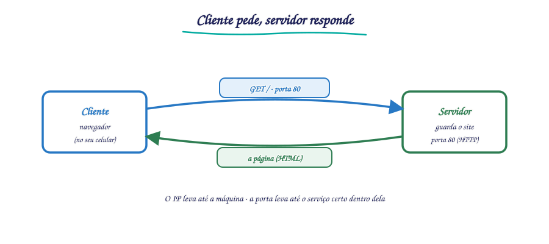
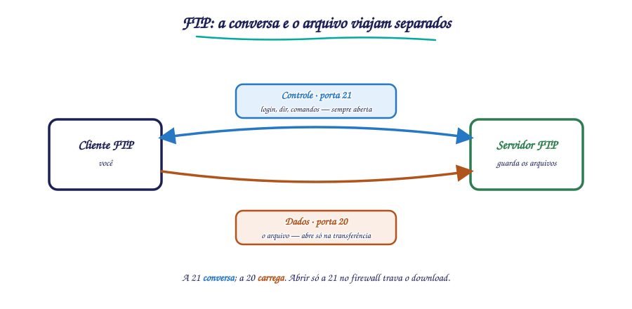

# 🌐 Aula 08 — Protocolos de Aplicação: HTTP e FTP

**Disciplina:** {{CODIGO}} — Redes de Computadores I · Sistemas de Informação — Uniube 
**Professor:** Romualdo Mathias Filho · **romualdo.filho@uniube.br** 
**Período:** {{PERIODO}} · 🔄 Teórico-Prática (75 min) 
**Página de referência:** [Plano de Ensino e Contrato](./Plano-de-Ensino-e-Contrato)

---

<b>Nosso caminho até aqui</b>

Responda **antes** de abrir. Se errar, você acabou de descobrir o que revisar hoje. Tudo isto veio da aula de transporte — é o chão sobre o qual a de hoje se apoia.

O que a camada de transporte (TCP/UDP) faz que a de rede (IP) não faz?

O **IP** (Internet Protocol) leva o pacote até a máquina certa, mas não garante que ele chegue, nem em ordem. O **TCP** (Transmission Control Protocol) acrescenta a **confiabilidade**: entrega ordenada, confirmada e sem perda. O **UDP** (User Datagram Protocol) abre mão disso em troca de velocidade. HTTP e FTP, de hoje, rodam sobre **TCP** — porque página e arquivo não podem chegar pela metade.

Para que serve o número de porta?

Para dizer **qual aplicação** no mesmo host deve receber o dado. O IP leva até a máquina; a **porta** leva até o programa certo dentro dela. A porta **80** é o endereço combinado do serviço web; a **21**, do controle do FTP. Hoje você vê o que trafega depois que o three-way handshake abriu essa porta.

O que é o modelo cliente-servidor?

Um papel pede (o **cliente**: seu navegador), outro responde (o **servidor**: a máquina que guarda o site). Quase todo protocolo de aplicação segue esse formato. Hoje você monta os dois lados no Packet Tracer e vê a conversa acontecer.

> [!INFO] 🎯 O que você leva desta aula
> - O que é a **camada de aplicação** e por que ela é o topo da pilha — onde o usuário de fato vive.
> - Como o **HTTP** (Hypertext Transfer Protocol) move páginas web, e o que são os métodos `GET` e `POST`.
> - Como o **FTP** (File Transfer Protocol) move arquivos, e **por que ele usa duas portas** (a parte que mais confunde).
> - Montar e testar, no **Packet Tracer**, um servidor HTTP e um servidor FTP de verdade.
>
> **📂 Recursos**
> - [Plano de Ensino e Contrato](./Plano-de-Ensino-e-Contrato) — calendário, notas, prazos e regras.
> - **Packet Tracer** — o laboratório desta aula, onde você sobe os dois servidores.

---

## 📌 1. Por que existe uma camada de aplicação [Fundamentação ⏳ 10 min]

A internet é feita de cabos, luz e ondas de rádio — mas ninguém "usa" um cabo. As pessoas usam **páginas web, arquivos, mensagens**. A pergunta que a camada de aplicação responde é: *como o dado bruto que chegou pela rede vira algo que um programa entende e mostra ao usuário?*

As camadas de baixo já fizeram o trabalho pesado: a **física** pôs o bit no meio, a de **enlace** entregou o quadro ao vizinho, a de **rede** (IP) levou o pacote até a máquina certa, a de **transporte** (TCP/UDP) garantiu a entrega e escolheu a aplicação pela porta. A **camada de aplicação** é o topo: é onde o HTTP, o FTP, o DNS (Domain Name System) e o e-mail traduzem tudo isso em serviço útil.

Quase todo protocolo dessa camada segue o **modelo cliente-servidor**: um lado **pede** (o cliente — o navegador no seu celular), o outro **responde** (o servidor — o datacenter do Google ou da Uniube, que guarda o recurso).

<figure class="au-fig">

<figcaption class="au-legenda">Figura 1: o modelo cliente-servidor — o cliente pede pela porta combinada, o servidor responde.</figcaption>
</figure>

> [!NOTE] 📖 Onde a porta entra
> O IP leva o pacote até a **máquina**; a **porta** leva até a **aplicação** dentro dela. Por isso os serviços têm portas combinadas: um navegador que quer uma página procura a porta **80** (HTTP); um cliente FTP procura a porta **21**. A porta é o endereço do serviço, não da máquina.

---

## 📌 2. HTTP: o idioma da web [Teoria ⏳ 14 min]

O **HTTP** (Hypertext Transfer Protocol) é o protocolo que transfere as páginas web — o HTML (Hypertext Markup Language, a linguagem das páginas), as imagens, os vídeos e os scripts. Ele roda sobre **TCP**, na **porta 80** (ou **443** para o HTTPS, a versão cifrada).

O HTTP funciona por **requisição e resposta**: o cliente manda uma requisição com um **método**, o servidor processa e devolve uma resposta. Os dois métodos que você precisa conhecer hoje:

| Método | O que faz | Exemplo do dia a dia |
| :-- | :-- | :-- |
| **`GET`** | **pede** um recurso ao servidor (uma página, uma imagem) | digitar um endereço e abrir o site |
| **`POST`** | **envia** dados do cliente para o servidor | clicar em "Entrar" mandando usuário e senha |

> [!TIP] 💡 GET pede, POST envia
> A regra prática: se você está **lendo** algo (abrindo uma página), é quase sempre um `GET`. Se você está **enviando** algo que muda o estado do servidor (um login, um formulário, um comentário), é um `POST`. Essa distinção reaparece em toda a web — e é a base de como as APIs funcionam.

> [!NOTE] 📖 HTTP e HTTPS
> O **HTTPS** (HTTP Secure) é o mesmo HTTP, mas dentro de um túnel cifrado (TLS — Transport Layer Security), na porta **443**. O conteúdo trafega igual; o que muda é que ninguém no caminho consegue ler. Hoje praticamente toda a web é HTTPS — o cadeado do navegador é exatamente isso.

---

## 📌 3. FTP: mover arquivos, e por que duas portas [Teoria ⏳ 16 min]

O **FTP** (File Transfer Protocol) é feito para **transferir arquivos** — baixar (download) e enviar (upload). Roda sobre **TCP**, e aqui está o ponto que mais confunde: **o FTP usa duas conexões, em duas portas diferentes**, e isso tem um motivo.

- **Porta 21 — conexão de controle:** é por onde o cliente **manda os comandos** e recebe as respostas. "Faça login", "liste os arquivos", "quero baixar tal arquivo". Essa conexão fica aberta durante toda a sessão.
- **Porta 20 — conexão de dados:** é por onde o **arquivo em si** trafega. Ela abre só quando há transferência e fecha quando termina.

<figure class="au-fig">

<figcaption class="au-legenda">Figura 2: o FTP separa comando (porta 21) e dados (porta 20) — a conversa não se mistura com o arquivo.</figcaption>
</figure>

Antes de rolar: por que o FTP não faz tudo numa porta só, como o HTTP? O que ganha ao separar comando e dado em duas conexões?

**Ganha poder mandar um comando no meio de uma transferência.** Com o controle (porta 21) numa conexão própria e sempre aberta, o cliente pode mandar "aborte" ou "liste outra pasta" **enquanto** o arquivo ainda trafega pela porta de dados (20). Se tudo dividisse um canal só, o comando teria de esperar o arquivo inteiro passar — e não daria para interromper nada no meio. Separar é o que deixa a sessão FTP continuar "conversando" durante a transferência.

Por que separar? Para o **comando não se misturar com o dado**. Com a conexão de controle sempre aberta numa porta própria, o cliente pode mandar um novo comando (por exemplo, abortar) **enquanto** o arquivo ainda está sendo transferido na outra porta. Se tudo dividisse um único canal, o comando teria de esperar o arquivo inteiro passar.

> [!WARNING] ⚠️ O erro clássico: "FTP é uma porta só"
> É fácil decorar "FTP = porta 21" e parar aí. Mas a 21 é só o **controle** — o canal onde você digita os comandos e faz login. O **arquivo** trafega pela **20** (no modo ativo clássico). Duas portas, dois papéis: a 21 conversa, a 20 carrega. Quem esquece isso trava na hora de liberar o FTP num firewall, porque abre só a 21 e a transferência nunca completa.

> [!NOTE] 📖 Modo ativo e modo passivo
> O esquema "controle na 21, dados na 20" é o **modo ativo** clássico. Existe também o **modo passivo** (comando PASV), criado porque o modo ativo não funcionava bem através de firewalls e NAT (Network Address Translation): no passivo, a porta de dados é negociada dinamicamente e **quem abre a conexão de dados é o cliente**, não o servidor. Hoje o passivo é o mais usado na internet. No laboratório de hoje, o Packet Tracer cuida disso por baixo — o que importa é você entender **por que** existem duas conexões.

---

## 📌 4. Mão na massa: HTTP e FTP no Packet Tracer [Prática ⏳ 20 min]

Agora você monta os dois serviços num ambiente controlado e vê a conversa acontecer.

<b>Prática — 20 min, individual ou em duplas</b>

**Etapa 1 — montar a rede**
1. Coloque um **Switch** central.
2. Conecte dois **PCs** e um **Server** (servidor genérico) ao switch.
3. Dê IPs fixos na mesma rede:
   - Server: `192.168.0.10` · máscara `255.255.255.0`
   - PC-1: `192.168.0.20` · PC-2: `192.168.0.21` · mesma máscara

**Etapa 2 — ligar os serviços no Server** (aba *Services*)
4. **HTTP:** clique em *On*. Edite o `index.html` com um texto seu, por exemplo `<h1>Servidor Uniube</h1>`.
5. **FTP:** clique em *On*. Crie um usuário `aluno` com senha e marque as permissões (Write, Read, List...).

**Etapa 3 — testar**
6. No **Desktop do PC-1**, abra o **Web Browser**, digite `192.168.0.10` e confirme. A página deve aparecer.
7. No **Command Prompt do PC-1**, rode `ftp 192.168.0.10`, informe o usuário e a senha, digite `dir` para listar e `quit` para sair.

<b>Critério de pronto:</b> a página do servidor abre no navegador do PC-1 (HTTP funcionando) **e** o `dir` lista os arquivos do servidor via FTP. Se um funcionar e o outro não, você já sabe qual serviço revisar.

> [!TIP] 💡 Antes de culpar o serviço, teste a rede
> Se a página não abre, não mexa logo no HTTP: rode um **`ping 192.168.0.10`** do PC-1 primeiro. Sem `ping`, o problema é de **rede** (IP, máscara, cabo), não do serviço de aplicação. Com `ping` e sem página, aí sim o problema está no HTTP. Diagnóstico é do físico ao lógico, sempre.

---

<b>🔌 Momento interativo — vote antes de eu abrir o Packet Tracer</b>

Você liberou o FTP no firewall do servidor abrindo **só a porta 21**. O login funciona, você consegue listar os arquivos com `dir`, mas quando tenta **baixar** um arquivo, a transferência **trava**. **Por quê?** Vote no Plickers.

<b>Plano B — se o Plickers ou a internet do campus cair:</b> mão levantada — faltou abrir a porta de dados (um dedo) ou a senha está errada (dois dedos). A resposta e o porquê vêm logo abaixo; o importante é você se comprometer com um palpite antes de ver.

<b>📋 Resumo — a folha de consulta</b>

| Conceito | O que é | Como lembrar |
|---|---|---|
| Camada de aplicação | o topo da pilha, onde o usuário vive | HTTP, FTP, DNS, e-mail |
| Modelo cliente-servidor | um pede, o outro responde | cliente = navegador; servidor = datacenter |
| Porta | endereço da aplicação dentro da máquina | IP = máquina; porta = programa |
| HTTP (porta 80) | move páginas web, sobre TCP | `GET` pede · `POST` envia |
| HTTPS (porta 443) | HTTP dentro de túnel cifrado (TLS) | o cadeado do navegador |
| FTP controle (porta 21) | canal dos comandos e do login | a 21 **conversa** |
| FTP dados (porta 20, modo ativo) | canal do arquivo em si | a 20 **carrega** |
| Modo passivo (PASV) | cliente abre a conexão de dados | criado para firewall/NAT |

| O erro clássico | A correção |
|---|---|
| "HTTP e FTP são a mesma coisa" | não — HTTP move **página**, FTP move **arquivo** |
| "FTP usa uma porta só (21)" | não — 21 é controle, **20** é dados |
| "abri a 21 no firewall, o FTP está liberado" | não — sem a porta de dados, a transferência trava |
| "GET e POST são iguais" | não — `GET` **pede**, `POST` **envia** |

---

<b>🤔 Para pensar até a próxima aula</b>

Hoje o HTTP pediu a página por um endereço IP (<code>192.168.0.10</code>). Mas na internet real você digita <code>uniube.br</code>, não um número. Alguém, em algum lugar, traduz o nome no IP antes de o HTTP sequer começar. <b>Quem faz essa tradução, e o que acontece se esse tradutor cair?</b> Traga sua hipótese — a resposta tem três letras e é o assunto que amarra tudo o que vimos.

<i>Não há resposta nesta página de propósito.</i>

---

## 🧩 Antes de fechar: a analogia que amarra tudo

Pense num **restaurante**. O **cliente-servidor** é você (cliente) e a cozinha (servidor): você pede, ela entrega. O **HTTP** é o cardápio e o pedido do prato — você aponta o que quer (`GET`) ou manda uma observação para a cozinha (`POST`). O **FTP** é a entrega de uma **encomenda grande** nos fundos: tem uma portinha onde o garçom anota o pedido e conversa com você (a **porta 21**, o controle) e uma **doca de carga** separada por onde a mercadoria pesada entra e sai (a **porta 20**, os dados). Misturar as duas — mandar o caminhão pela porta da conversa — é o que trava tudo. E a **porta** (o número) é a placa na porta certa: sem ela, a entrega chega ao prédio (o IP) mas não sabe em qual sala parar.

---

<b>📚 O que sustenta esta aula, com página</b>

- **KUROSE, J. F.; ROSS, K. W.** *Redes de computadores e a Internet: uma abordagem top-down.* 8. ed. São Paulo: Pearson, 2021. cap. 2 — Camada de Aplicação — HTTP, FTP e o modelo cliente-servidor. Páginas específicas **não conferidas nesta edição** — confirmar antes de citar número de página.
- **TANENBAUM, A. S.; FEAMSTER, N.; WETHERALL, D. J.** *Redes de Computadores.* 6. ed. São Paulo: Pearson, 2021. cap. 7 — Camada de Aplicação — protocolos de transferência e o modelo de requisição-resposta.
- **CLOUDFLARE.** *O que é FTP?* Disponível em: [cloudflare.com](https://www.cloudflare.com/pt-br/learning/network-layer/what-is-ftp/). Acesso em: 14 maio 2026. — introdução acessível às diferenças entre FTP e HTTP.

<b>➡️ Na próxima aula</b>

Hoje você acessou o servidor pelo número <code>192.168.0.10</code>. Mas ninguém decora IP — a gente digita <b>nome</b>. Na próxima aula entra o serviço que faz a ponte entre o nome e o número, o que acontece quando ele falha, e por que ele é, silenciosamente, um dos serviços mais críticos da internet inteira.

%%
BANCO DE QUESTÕES — Aula 08 (Protocolos de Aplicação: HTTP e FTP)
Uso interno do professor. 4 questões de múltipla escolha com gabarito.

1) Sobre o HTTP, qual par método → ação está correto?
   a) GET envia dados de formulário; POST pede uma página.
   b) GET pede um recurso ao servidor; POST envia dados do cliente ao servidor.
   c) GET e POST fazem exatamente a mesma coisa.
   d) GET é usado só em HTTPS; POST só em HTTP.
   GABARITO: b)  —  GET pede (leitura); POST envia (ex.: login, formulário).

2) Por que o FTP usa DUAS portas (21 e 20), e qual é o papel de cada uma?
   a) Para ser mais rápido; as duas transferem arquivo ao mesmo tempo.
   b) 21 = controle (comandos e login); 20 = dados (o arquivo em si) — separar evita que o comando
      espere o arquivo inteiro passar.
   c) 21 = dados; 20 = controle.
   d) É um defeito histórico sem função.
   GABARITO: b)  —  a 21 conversa (controle), a 20 carrega (dados).

3) Um administrador liberou SÓ a porta 21 do FTP no firewall. O login e o `dir` funcionam, mas o
   download de um arquivo trava. Qual é a causa mais provável?
   a) A senha do usuário está errada.
   b) O servidor HTTP está desligado.
   c) Faltou liberar a porta de DADOS — sem ela, o controle (21) funciona mas a transferência não
      completa.
   d) O cabo de rede está rompido.
   GABARITO: c)  —  abrir só a 21 permite conversar e logar, mas não transferir; falta a porta de dados.

4) Em qual porta o HTTP roda por padrão, e sobre qual protocolo de transporte?
   a) Porta 21, sobre UDP.
   b) Porta 443, sobre UDP.
   c) Porta 80, sobre TCP (443 para HTTPS).
   d) Porta 20, sobre TCP.
   GABARITO: c)  —  HTTP = porta 80 sobre TCP; HTTPS = porta 443 (TCP) com TLS.
%%
