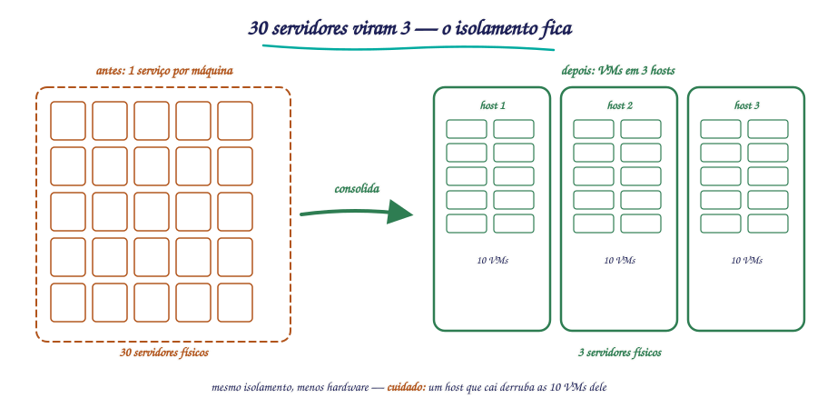
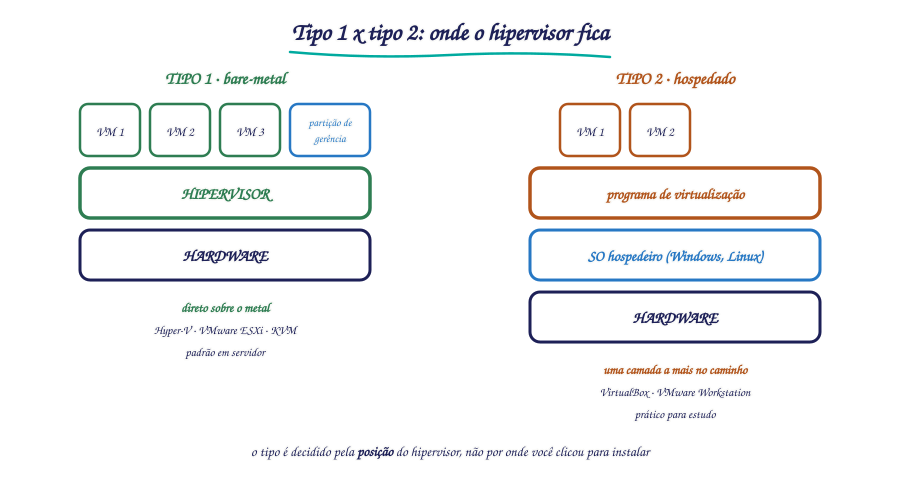
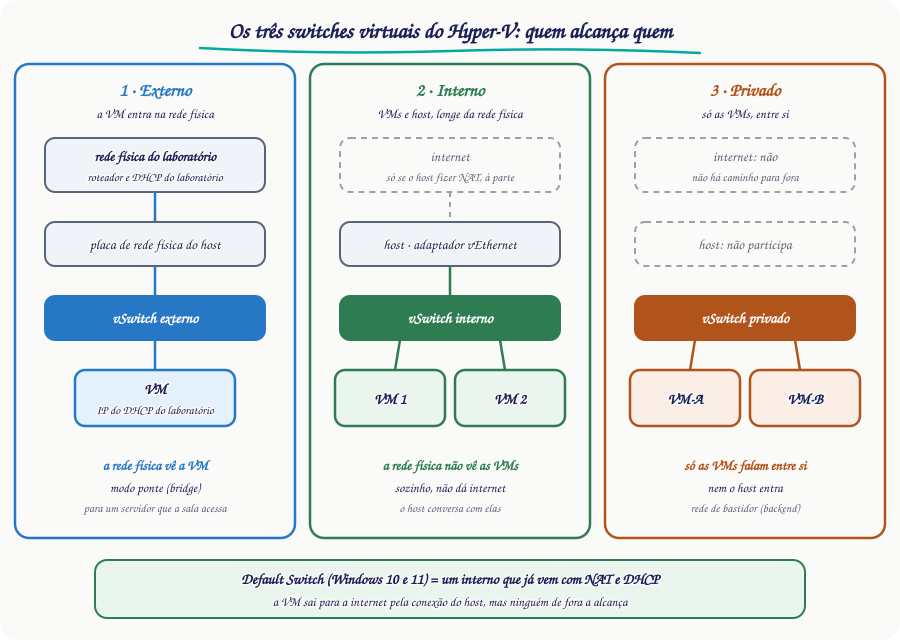

# 🖥️ Aula 09 — Redes Virtuais: VMs, ISOs e Hyper-V

**Disciplina:** {{CODIGO}} — Redes de Computadores I · Sistemas de Informação — Uniube 
**Professor:** Romualdo Mathias Filho · **romualdo.filho@uniube.br** 
**Período:** {{PERIODO}} · 📘 Teórica (75 min) · turma conjunta · 04/11/2026 
**Página de referência:** [Plano de Ensino e Contrato](./Plano-de-Ensino-e-Contrato)

---

<b>Nosso caminho até aqui</b>

Responda **antes** de abrir. Se errar, você acabou de descobrir o que revisar hoje. As três perguntas vêm das Aulas 04, 06 e 08, e cada uma reaparece hoje dentro de uma máquina virtual.

Como o switch descobre em qual porta está cada máquina, sem ninguém configurar?

Ele grava o **MAC de origem** de cada quadro que chega, junto com a porta por onde entrou (Aula 04). Hoje você vê um switch que faz o mesmo trabalho sem existir em metal: o **switch virtual**, um programa que liga máquinas virtuais.

Dois computadores com IP na mesma sub-rede precisam de roteador para conversar?

Não. Na mesma sub-rede eles se falam direto, pelo switch (Aula 06). É por isso que, hoje, ligar a máquina virtual e o seu computador à **mesma rede de camada 2** basta para os dois trocarem pacotes — e é por isso também que, no switch privado, nem isso resolve: lá o host nem participa da rede.

Um servidor web é um computador ou um programa?

É um **programa** que escuta numa porta, a 80 ou a 443 (Aula 08). O computador só o hospeda. Se o servidor é um programa, por que ele precisaria de uma máquina física inteira só para ele? Essa é a pergunta que abre a aula.

> [!INFO] 🎯 O que você leva desta aula
> - Por que empresas trocam dezenas de servidores físicos por poucos, sem perder o isolamento entre serviços.
> - O que é uma **VM** (*Virtual Machine*, máquina virtual) e o **hipervisor** que a sustenta, nos tipos 1 e 2.
> - A diferença entre **host** e **guest**, e entre o arquivo **ISO** e o disco **VHD**.
> - Como ativar o **Hyper-V** no Windows, criar uma VM e escolher o **switch virtual** certo: externo, interno ou privado.
>
> **📂 Recursos**
> - [Plano de Ensino e Contrato](./Plano-de-Ensino-e-Contrato) — calendário, notas, prazos e regras.
> - [Microsoft Learn — Instalar o Hyper-V](https://learn.microsoft.com/pt-br/windows-server/virtualization/hyper-v/get-started/install-hyper-v) — requisitos e ativação.
> - [Microsoft Learn — Criar um switch virtual](https://learn.microsoft.com/pt-br/windows-server/virtualization/hyper-v/get-started/create-a-virtual-switch-for-hyper-v-virtual-machines) — os três tipos de switch.

---

## 📌 1. Por que virtualizar: o custo de um servidor por máquina [Fundamentação ⏳ 10 min]

Durante muito tempo, cada serviço de uma empresa ganhava um computador próprio. O e-mail num servidor, os arquivos em outro, o banco de dados num terceiro, o site num quarto. A regra tinha um motivo bom: **isolamento**. Se o banco de dados travasse o sistema, o e-mail não caía junto.

O problema é o que essa regra custa. Cada servidor físico traz CPU (*Central Processing Unit*, unidade central de processamento), RAM (*Random Access Memory*, memória de acesso aleatório), fonte, disco, espaço no armário de servidores (o *rack*), energia, refrigeração, cabo e porta de switch. E um servidor dedicado a um único serviço costuma passar boa parte do tempo esperando requisição.

A virtualização separa as duas coisas que estavam coladas. O **isolamento** continua: cada serviço roda no próprio sistema, numa VM. O **hardware** passa a ser dividido: várias VMs rodam no mesmo servidor físico, cada uma achando que tem uma máquina só para ela.

Veja num exemplo da aula, com números redondos para a conta ficar visível:

| Situação | Antes: 1 servidor por serviço | Depois: virtualizado |
| :-- | :-- | :-- |
| Serviços | 30 | 30 (um por VM) |
| Servidores físicos | 30 | 3, com 10 VMs cada |
| Portas de switch físico (no mínimo uma por servidor) | 30 | 3 |
| Isolamento entre serviços | uma máquina por serviço | uma VM por serviço |
| Servidor novo | comprar, instalar e cabear hardware | criar mais uma VM num host com folga |

<figure class="au-fig">

<figcaption class="au-legenda">Figura 1: a consolidação — 30 serviços que ocupavam 30 servidores físicos passam a rodar como 30 VMs em 3 servidores físicos, cada serviço ainda isolado na própria VM.</figcaption>
</figure>

Três motivos levam alguém a virtualizar, e os três aparecem na sua vida profissional:

1. **Consolidação:** menos hardware para o mesmo número de serviços.
2. **Isolamento:** cada serviço tem SO (sistema operacional) próprio; um travamento não derruba o vizinho.
3. **Laboratório:** você monta uma rede com vários servidores dentro do seu notebook, testa, quebra e apaga, sem tocar em nada real.

> [!WARNING] ⚠️ Cuidado: consolidar também concentra o risco
> No exemplo, se um dos 3 servidores físicos queimar, **10 serviços caem de uma vez**, e não um. Por isso, quem consolida planeja folga: os hosts que sobram precisam ter CPU e RAM livres para religar as VMs do que caiu. Virtualizar sem essa folga troca 30 riscos pequenos por 3 riscos grandes.

> [!NOTE] 📖 A nuvem é isto, em escala
> Quando você aluga uma máquina na AWS, no Azure ou no Google Cloud, recebe uma VM rodando num hipervisor do provedor, num servidor físico que você nunca vai ver. Os conceitos de hoje são os mesmos; muda o tamanho.

---

## 📌 2. VM e hipervisor: quem divide o hardware [Teoria ⏳ 10 min]

Uma **VM** é um computador feito de software: tem CPU, RAM, disco e placa de rede **virtuais**, e roda um SO completo, como se fosse uma máquina de verdade. Quem cria essa ilusão e reparte o hardware real entre as VMs é o **hipervisor\***.

Dois nomes aparecem o tempo todo e vale fixar agora:

| Termo | O que é | No seu laboratório |
| :-- | :-- | :-- |
| **Host** (hospedeiro) | a máquina física e o sistema que controla o hardware | o seu notebook com Windows |
| **Guest** (convidado) | o sistema que roda dentro da VM | o Ubuntu Server instalado na VM |

O hipervisor existe em dois tipos, e a diferença é **onde ele está** em relação ao hardware:

| Tipo | Onde roda | Exemplos | Consequência |
| :-- | :-- | :-- | :-- |
| **Tipo 1** (*bare-metal*, "metal nu") | direto sobre o hardware, sem SO por baixo | Hyper-V, VMware ESXi, KVM\* | menos camadas entre a VM e o hardware; é o padrão em servidor |
| **Tipo 2** (hospedado) | como um programa dentro de um SO comum | VirtualBox, VMware Workstation | mais camadas, porque cada pedido da VM passa pelo SO hospedeiro; prático para estudo |

<figure class="au-fig">

<figcaption class="au-legenda">Figura 2: no tipo 1, o hipervisor fica logo acima do hardware; no tipo 2, existe um sistema operacional inteiro entre o hipervisor e o hardware.</figcaption>
</figure>

Antes de rolar: você ativa o Hyper-V no seu Windows 11 e reinicia. Onde o Windows que você está usando passa a rodar?

**Sobre o hipervisor, como uma partição privilegiada\*.** O Hyper-V é tipo 1 mesmo no notebook: ao ativá-lo, o hipervisor passa a carregar antes do Windows, direto sobre o hardware. O Windows de sempre continua na tela, mas agora roda numa camada acima do hipervisor e ganha o papel de gerenciar as outras VMs. Parece tipo 2, porque você o liga "dentro do Windows", e é justamente essa a pegadinha.

* <b>Hipervisor:</b> software que cria as máquinas virtuais e reparte entre elas a CPU, a RAM, o disco e a rede da máquina física. · <b>KVM</b> (<i>Kernel-based Virtual Machine</i>): módulo do kernel (o núcleo do sistema operacional) do Linux que transforma o próprio Linux em hipervisor; por isso entra na coluna do tipo 1. · <b>Partição privilegiada</b> (ou partição raiz): no Hyper-V, é onde o Windows de gerência roda, com acesso direto aos dispositivos e controle sobre as outras VMs.

---

## 📌 3. ISO e VHD: o disco de instalação e o disco da VM [Teoria ⏳ 8 min]

Uma VM nova é como um computador recém-montado: tem disco vazio e nenhum SO. Para instalar o sistema você precisa de dois arquivos, com papéis bem diferentes.

O **arquivo ISO** (extensão `.iso`, do padrão ISO 9660 da *International Organization for Standardization*, o formato de imagem de CD/DVD) é a imagem de um disco de instalação: um único arquivo com o conteúdo inteiro de um CD ou DVD. Você o "insere" na unidade de DVD virtual da VM, e ela dá a partida por ele como daria por um disco físico.

O **VHD** (*Virtual Hard Disk*, disco rígido virtual) é o disco da VM. É um arquivo no disco do host que, para o guest, aparece como um HD (*hard disk*, disco rígido) inteiro. O Hyper-V usa hoje o formato **VHDX**, a versão mais nova do VHD, que aceita discos maiores e protege melhor os dados numa queda de energia.

| Aspecto | Arquivo ISO | Arquivo VHD / VHDX |
| :-- | :-- | :-- |
| Papel | mídia de instalação | disco onde o SO fica instalado |
| A VM lê ou escreve? | só lê | lê e escreve |
| Quando é usado | na instalação; depois, pode ser ejetado | o tempo todo, enquanto a VM existir |
| Pode servir a várias VMs? | sim, a mesma ISO instala quantas VMs você quiser | em regra, não; cada VM tem o seu disco |
| Se você apagar o arquivo | perde o instalador, a VM continua | **perde a VM inteira** |

A instalação, então, segue sempre a mesma ordem:

1. Crie a VM com um VHDX novo e vazio.
2. Monte a ISO na unidade de DVD virtual.
3. Dê a partida pela ISO e instale o SO **no VHDX**.
4. Ejete a ISO. Daqui em diante, a VM dá a partida pelo próprio disco.

> [!TIP] 💡 Dica: baixe a ISO da fonte oficial e confira o hash
> Fontes oficiais para o laboratório: [Ubuntu Server](https://ubuntu.com/download/server), [Debian](https://www.debian.org/distrib/) e o [Microsoft Evaluation Center](https://www.microsoft.com/evalcenter) para o Windows Server. O site oficial publica o **hash** (uma "impressão digital" do arquivo, calculada por um algoritmo como o SHA-256). No PowerShell, `Get-FileHash arquivo.iso` calcula o seu; se não bater, a ISO veio corrompida ou adulterada.

---

## 📌 4. Hyper-V no Windows: requisitos e ativação [Teoria ⏳ 8 min]

O **Hyper-V** é o hipervisor da Microsoft. Ele já vem dentro do Windows como um recurso opcional: não existe download, você só o ativa. A documentação da Microsoft lista estes requisitos para o Windows 10 e 11:

| Requisito | O que conferir |
| :-- | :-- |
| Edição do Windows | Pro, Enterprise ou Education; o **Home não aceita** o Hyper-V |
| Processador | 64 bits, com SLAT\* |
| Extensões de virtualização | Intel VT-x ou AMD-V, **ativadas no firmware** (BIOS ou UEFI\*) |
| Memória | mínimo de 4 GB de RAM |

São três caminhos para ativar, todos como administrador:

1. **PowerShell:** `Enable-WindowsOptionalFeature -Online -FeatureName Microsoft-Hyper-V -All`
2. **DISM** (*Deployment Image Servicing and Management*, a ferramenta de manutenção de imagens do Windows): `DISM /Online /Enable-Feature /All /FeatureName:Microsoft-Hyper-V`
3. **Interface:** Painel de Controle → Programas → Ativar ou desativar recursos do Windows → marcar **Hyper-V**.

Nos três casos, o Windows pede para **reiniciar**. É nesse reinício que o hipervisor passa a carregar por baixo do Windows, como você viu na aposta da seção 2.

> [!WARNING] ⚠️ Cuidado: Hyper-V e VirtualBox disputam o mesmo recurso
> Com o hipervisor do Hyper-V ativo, programas como o VirtualBox e o VMware Workstation, que usam as mesmas extensões do processador, podem não iniciar as VMs deles, ou rodar instáveis. Se você já usa um deles, decida antes qual hipervisor fica no seu notebook.

* <b>SLAT</b> (<i>Second Level Address Translation</i>, tradução de endereço em segundo nível): recurso do processador que traduz a memória da VM para a memória física no próprio hardware, sem o hipervisor fazer essa conta em software. · <b>UEFI</b> (<i>Unified Extensible Firmware Interface</i>): o firmware que sucedeu à BIOS (<i>Basic Input/Output System</i>); é a tela de configuração que abre antes do sistema, onde se liga a virtualização. · <b>Firmware</b>: o programa gravado no chip da placa-mãe que acorda o hardware antes do sistema operacional; BIOS e UEFI são os dois tipos que você encontra.

---

## 📌 5. Criar uma VM no Hyper-V, passo a passo [Teoria ⏳ 8 min]

Com o Hyper-V ativo, o **Gerenciador do Hyper-V** cria a VM por um assistente. O roteiro resumido, com os valores que usamos no laboratório:

1. **Novo → Máquina Virtual** e dê um nome: `SRV-UBUNTU-REDES`.
2. **Geração:** escolha a **Geração 2** (detalhe na tabela abaixo).
3. **Memória:** 2048 MB, com **Memória Dinâmica** marcada, para o host emprestar RAM à VM só quando ela precisar.
4. **Rede:** ligue ao **Default Switch**, para a VM ter internet durante a instalação (seção 6).
5. **Disco:** crie um VHDX novo de 20 GB, suficiente para um Ubuntu Server de laboratório.
6. **Instalação:** aponte a ISO, por exemplo `ubuntu-24.04-live-server-amd64.iso`.
7. **Antes de ligar** uma VM Linux: Configurações → Segurança → Inicialização Segura\* → modelo **Autoridade de Certificação UEFI da Microsoft**.
8. Conecte, inicie a VM e siga o instalador do SO.

| Geração | Firmware da VM | Quando usar |
| :-- | :-- | :-- |
| Geração 1 | BIOS emulada | SO antigo, que não dá partida por UEFI |
| **Geração 2** | UEFI, com Inicialização Segura | SO atual: Windows 10 e 11, Windows Server, Ubuntu e outras distribuições Linux recentes |

> [!WARNING] ⚠️ Cuidado: VM Linux de Geração 2 que não dá partida
> O modelo padrão da Inicialização Segura na Geração 2 é o do Windows. Com ele, a VM recusa a partida de um Linux, e parece que a ISO está estragada. A ISO está boa: troque o modelo para **Autoridade de Certificação UEFI da Microsoft** (passo 7) e tente de novo.

* <b>Inicialização Segura</b> (<i>Secure Boot</i>): recurso do UEFI que só deixa dar a partida um carregador de sistema assinado por uma autoridade que o firmware reconhece; impede que um programa malicioso se instale antes do SO.

---

## 📌 6. Switch virtual: externo, interno e privado [Teoria ⏳ 13 min]

Uma VM com placa de rede e sem cabo não fala com ninguém. O "cabo" dela é o **switch virtual**: um switch de camada 2 feito em software, dentro do host, que encaminha quadros pelo endereço MAC como o switch físico da Aula 04. O Hyper-V oferece três tipos, e a diferença entre eles é **quem alcança quem**.

<figure class="au-fig">

<figcaption class="au-legenda">Figura 3: os três tipos de switch virtual. O externo põe a VM na rede física; o interno liga VMs e host, longe da rede física; o privado liga só as VMs entre si.</figcaption>
</figure>

### 6.1 Externo: a VM entra na rede física

O switch **externo** se prende à placa de rede física do host. A VM passa a aparecer na rede do laboratório como mais um computador, com MAC e IP próprios, recebidos do mesmo DHCP (*Dynamic Host Configuration Protocol*, o serviço que entrega IP automaticamente) que atende as outras máquinas. Esse modo se chama **ponte\*** (*bridge*). Uso típico: um servidor que todos os PCs da sala precisam acessar.

### 6.2 Interno: VMs e host, longe da rede física

O switch **interno** cria uma rede só entre as VMs e o host. O Windows ganha um adaptador novo, `vEthernet (nome-do-switch)`, por onde conversa com elas. A rede física **não enxerga** essas VMs. E, sozinho, o switch interno **não dá internet**: para isso o host precisa fazer NAT\*, configurado à parte.

### 6.3 Privado: só as VMs, entre si

O switch **privado** liga apenas as VMs conectadas a ele. Nem o host participa, e não há caminho para a internet. Serve para simular uma rede de bastidor (*backend*): a rede interna dos serviços, que não fica exposta ao usuário — como a de um banco de dados que só o servidor de aplicação pode acessar.

### 6.4 O Default Switch, que já vem pronto

No Windows 10 e 11, o Hyper-V traz um switch chamado **Default Switch**. Ele é um switch interno **com NAT e DHCP já configurados**: a VM ligada a ele recebe IP sozinha e sai para a internet usando a conexão do host. Por isso é o modo mais cômodo para instalar o SO. Duas limitações: a faixa de IP é escolhida pelo Windows e pode mudar, e ninguém de fora alcança a VM.

| Tipo | VM → internet | VM ↔ host | VM ↔ VM | Rede física → VM | Ideia de rede por trás |
| :-- | :-- | :-- | :-- | :-- | :-- |
| **Externo** | sim, direto | sim, se o host compartilha a placa (padrão) | sim | **sim** | ponte (*bridge*) |
| **Interno** | não, sem NAT configurado | sim | sim | não | rede só com o host |
| **Default Switch** | sim, por NAT | sim | sim | não | interno + NAT + DHCP |
| **Privado** | não | **não** | sim | não | rede isolada entre VMs |

> [!WARNING] ⚠️ O erro clássico: "switch interno é NAT"
> Não é. O switch interno só liga VMs e host. O que dá internet ao Default Switch é o **NAT que vem junto**, e não o fato de ele ser interno. Um switch interno que você cria à mão fica sem internet até alguém configurar o NAT no host.

> [!TIP] 💡 Dica: NAT só funciona de dentro para fora
> Uma VM atrás de NAT abre conexões para a internet, mas ninguém de fora abre conexão para ela sem uma regra de redirecionamento de porta no host. É o mesmo motivo pelo qual ninguém acessa o computador da sua casa só sabendo o IP da operadora. Precisa que a sala inteira acesse a VM? Use o switch **externo**.

* <b>Ponte</b> (<i>bridge</i>): ligação em camada 2 que junta dois segmentos numa mesma rede; o quadro passa sem que o endereço IP seja trocado. · <b>NAT</b> (<i>Network Address Translation</i>, tradução de endereço de rede): técnica em que o host troca o IP privado das VMs pelo IP dele ao sair para a internet, e guarda uma tabela para devolver as respostas a quem pediu. · <b>Redirecionamento de porta</b> (<i>port forwarding</i>): regra no host que entrega o que chega num IP e porta de fora para uma VM de dentro; é o que abriria exceção ao "NAT só deixa sair".

---

<b>🖥️ Momento interativo — vote antes de eu abrir o Hyper-V</b>

Sua VM está ligada ao **Default Switch** e roda um servidor web. Um colega, em outro computador do laboratório, digita o IP dela e **não** abre nada. Você troca a VM para o switch **externo**. **O site abre para ele agora?** Vote no Plickers.

<b>Plano B — se o Plickers ou a internet do campus cair:</b> mão levantada — abre (um dedo) ou não abre (dois dedos). Depois da votação, voltamos à tabela da seção 6 para justificar; o importante é você se comprometer com um palpite antes de ver.

<b>🎧 Podcast da Aula 09 — Redes Virtuais</b>

O áudio chega em breve — gerado por IA a partir do material da disciplina.

<b>📋 Resumo — a folha de consulta</b>

| Conceito | O que é | Como lembrar |
|---|---|---|
| Consolidação | vários serviços, cada um na própria VM, em poucos servidores físicos | 30 servidores viram 3, sem perder o isolamento |
| VM | computador feito de software, com SO próprio | hardware virtual, sistema de verdade |
| Hipervisor | software que cria as VMs e reparte o hardware | o "síndico" do servidor físico |
| Tipo 1 | hipervisor direto sobre o hardware | Hyper-V, ESXi, KVM; padrão em servidor |
| Tipo 2 | hipervisor como programa dentro de um SO | VirtualBox, VMware Workstation |
| Host / guest | a máquina física / o sistema dentro da VM | quem hospeda / quem é hospedado |
| ISO | imagem de um disco de instalação | o "DVD" que você ejeta depois |
| VHD / VHDX | o disco rígido da VM, num arquivo | apagou, perdeu a VM |
| Geração 2 | VM com UEFI e Inicialização Segura | Linux pede o modelo de Autoridade de Certificação UEFI da Microsoft |
| Switch externo | VM na rede física, em ponte | a sala inteira enxerga |
| Switch interno | VMs e host, sem a rede física | só o host enxerga |
| Switch privado | só as VMs entre si | nem o host enxerga |
| Default Switch | interno com NAT e DHCP prontos | internet de dentro para fora |

| O erro clássico | A correção |
|---|---|
| "o Hyper-V é tipo 2, porque eu ligo pelo Windows" | não — ele é tipo 1; o Windows passa a rodar sobre o hipervisor |
| "a ISO é o disco da VM" | não — a ISO só instala; o SO fica no VHDX |
| "switch interno é NAT" | não — o NAT é configurado à parte; o Default Switch é que já vem com ele |
| "no Default Switch, os colegas acessam minha VM pelo IP" | não — NAT só deixa sair; para ser acessada, use o switch externo |
| "consolidar só traz vantagem" | não — um host que cai derruba todas as VMs que estavam nele |

---

<b>🤔 Para pensar até a próxima aula</b>

No switch externo, a sua VM pede um IP ao mesmo DHCP do laboratório e recebe um, sem você digitar nada. Para o servidor DHCP, ela é só mais um MAC pedindo endereço. Como ele sabe que aquele pedido veio de uma VM, e não de um computador físico? E faz alguma diferença ele saber?

<i>Não há resposta nesta página de propósito.</i>

---

## 🧩 Antes de fechar: a analogia que amarra tudo

Pense num prédio. O **servidor físico** é o prédio; cada **VM** é um apartamento, com porta e chave próprias. O **hipervisor tipo 1** é a estrutura do prédio, que divide água e luz entre os apartamentos; o **tipo 2** é um inquilino que aluga quartos para terceiros dentro do apartamento onde mora, e tudo passa por ele antes de chegar ao condomínio. A **ISO** é o caminhão de mudança: traz os móveis e vai embora; o **VHDX** é o apartamento mobiliado que fica. O **switch externo** é a porta que dá para a rua, o **interno** é o interfone que fala com os outros apartamentos e com a portaria, sem linha para fora, e o **privado** é o corredor entre apartamentos, sem ligação nem com a portaria.

---

<b>📚 O que sustenta esta aula</b>

- **TANENBAUM, A. S.; BOS, H.** *Sistemas Operacionais Modernos.* 4. ed. São Paulo: Pearson, 2016. cap. 7 (virtualização e a nuvem), página não conferida — hipervisores tipo 1 e tipo 2. Edição e páginas a conferir no acervo antes de citar número.
- **KUROSE, J. F.; ROSS, K. W.** *Redes de computadores e a Internet: uma abordagem top-down.* 8. ed. São Paulo: Pearson, 2021. cap. 4 (NAT) e cap. 6 (enlace, switches e VLAN), página não conferida — NAT e o switch de camada 2 que o switch virtual reproduz.
- **MICROSOFT.** *Instalar o Hyper-V.* Microsoft Learn. página web, sem paginação — requisitos do Windows 10 e 11, ativação por PowerShell, DISM e interface, conflito com outros hipervisores. Acesso em: 4 nov. 2026.
- **MICROSOFT.** *Criar e configurar um switch virtual com o Hyper-V.* Microsoft Learn. página web, sem paginação — switches externo, interno e privado, compartilhamento da placa com o sistema de gerência, rede NAT sobre switch interno. Acesso em: 4 nov. 2026.

<b>➡️ Na próxima aula</b>

Hoje a sua VM ganhou um IP sem você digitar nada, e você aceitou isso como mágica. Na próxima, abrimos a mágica: como um endereço IP se organiza, como o <b>DHCP</b> o entrega em quatro mensagens, e como o <b>Wireshark</b> deixa você ver cada uma delas passando pelo cabo.

