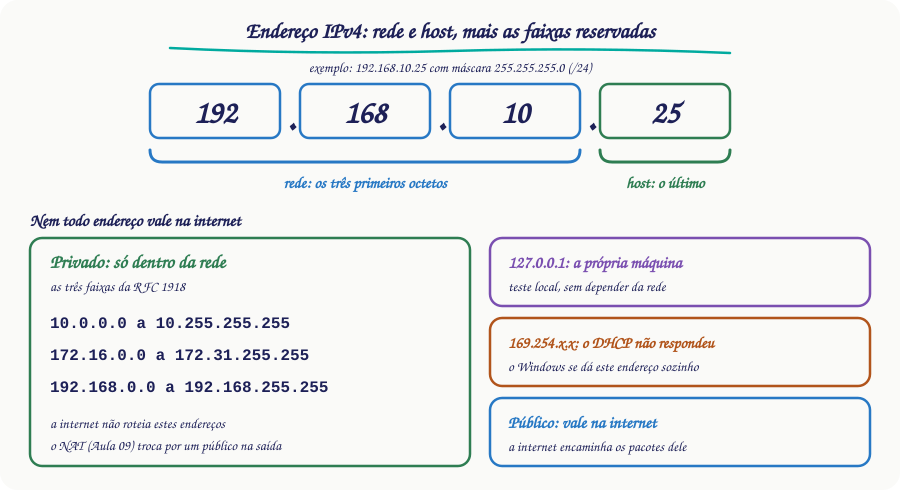
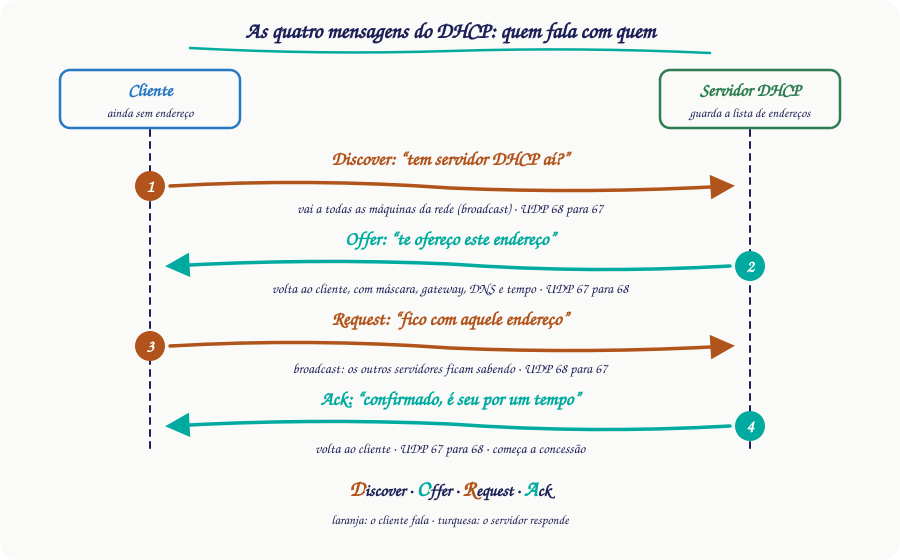
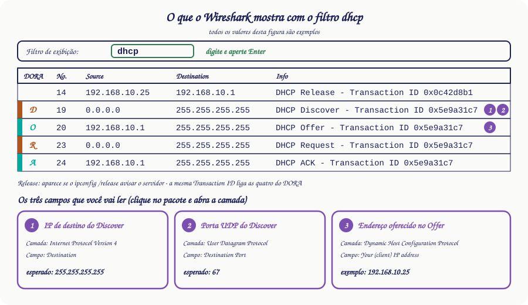

# 🌐 Aula 10 — Endereço IPv4, DHCP e Wireshark

**Disciplina:** {{CODIGO}} — Redes de Computadores I · Sistemas de Informação — Uniube 
**Professor:** Romualdo Mathias Filho · **romualdo.filho@uniube.br** 
**Período:** {{PERIODO}} · 📘 Teórica (75 min) · semana de 09/11/2026 
**Página de referência:** [Plano de Ensino e Contrato](./Plano-de-Ensino-e-Contrato)

---

### Como os 75 minutos se dividem hoje

| Momento | De–até (min) | Minutos |
| :-- | :-: | :-: |
| Entrada | 0–5 | 5 |
| Caminho até aqui: três perguntas de cabeça | 5–11 | 6 |
| 1. O endereço tem duas partes, e uma faixa é só de uso interno | 11–23 | 12 |
| 2. As quatro mensagens que entregam o endereço sozinho | 23–37 | 14 |
| Momento interativo: vote antes de abrir o Wireshark | 37–41 | 4 |
| 3. O Wireshark mostra as quatro mensagens passando | 41–55 | 14 |
| Prática: capture as quatro mensagens e leia três campos | 55–65 | 10 |
| Resumo, reflexão e próxima aula | 65–70 | 5 |
| Folga | 70–75 | 5 |

---

<b>Nosso caminho até aqui</b>

Responda **antes** de abrir. Se errar, você acabou de descobrir o que revisar hoje. As três perguntas vêm das Aulas 09, 06 e 07, e cada uma reaparece hoje.

Quem entrega o IP a uma máquina que entra na rede sem configuração?

**Um servidor DHCP** (*Dynamic Host Configuration Protocol*). Na Aula 09, foi o DHCP do laboratório que deu IP à VM no switch externo. Hoje você vê como ele entrega.

Num endereço /24, quais octetos formam a rede?

**Os três primeiros.** O quarto identifica a máquina (Aula 06). Hoje você usa essa divisão para separar endereço interno de endereço da internet.

O UDP (<i>User Datagram Protocol</i>) abre conexão antes de enviar dados?

**Não.** Ele manda direto, sem handshake (Aula 07). As mensagens do DHCP viajam sobre ele.

> [!INFO] 🎯 O que você leva desta aula
> - Separar um endereço **IPv4** (*Internet Protocol version 4*) em rede e host, e saber quais faixas são só de uso interno.
> - Dizer as quatro mensagens do DHCP, quem envia cada uma e por quais portas UDP elas passam.
> - Capturar essas mensagens no **Wireshark** e ler três campos delas.
>
> **📂 Recursos**
> - [Plano de Ensino e Contrato](./Plano-de-Ensino-e-Contrato) — calendário, notas, prazos e regras.
> - [Wireshark — download](https://www.wireshark.org/download.html) — o programa da captura de hoje.
> - [Microsoft Learn — ipconfig](https://learn.microsoft.com/en-us/windows-server/administration/windows-commands/ipconfig) — os comandos `/all`, `/release` e `/renew`.

---

## 📌 1. O endereço IPv4 tem duas partes, e uma faixa é só de uso interno [Teoria ⏳ 12 min]

Na Aula 06 você configurou endereços IPv4 à mão. Um endereço IPv4 tem 32 bits, escritos em quatro **octetos**\* separados por ponto, como `192.168.10.25`.

Num /24 (máscara `255.255.255.0`), os três primeiros octetos dizem **em que rede** a máquina está. O último diz **qual é a máquina** dentro dela: o **host**\*. O cálculo da máscara e das sub-redes fica para a Aula 11.

Nem todo endereço IPv4 vale na internet. Os endereços **privados** valem só dentro de uma rede. Os **públicos** são os que a internet roteia. Todas as redes da Aula 06 eram privadas: `192.168.10.0` e `192.168.20.0` (redes A e B), `172.16.0.0` (a de gerenciamento) e `10.0.0.0` (a da rota estática).

Antes de rolar: o endereço 172.20.5.9 é privado ou público?

**Privado.** A faixa que começa em `172.16.0.0` não termina nele: vai até `172.31.255.255`, e o `172.20.5.9` está dentro dela. As outras duas faixas privadas da RFC 1918\* vão de `10.0.0.0` a `10.255.255.255` e de `192.168.0.0` a `192.168.255.255`.

A RFC 1918 define essas três faixas e diz que a internet não as roteia. Por isso o NAT (*Network Address Translation*, Aula 09) troca o endereço privado por um público quando a máquina sai para a internet.

<figure class="au-fig">

<figcaption class="au-legenda">Figura 1: o endereço 192.168.10.25 num /24 tem três octetos de rede e um de host. Abaixo, as faixas reservadas: as três privadas, o loopback e o endereço automático 169.254. Os públicos são os que a internet encaminha.</figcaption>
</figure>

Dois endereços especiais completam o mapa. O `127.0.0.1` é o **loopback**\*, o endereço da própria máquina. O `169.254.x.x` é o endereço **APIPA**\* (*Automatic Private IP Addressing*): o Windows costuma se dar um desses quando nenhum servidor DHCP responde.

| Endereço | O que é | Quando você o vê |
| :-- | :-- | :-- |
| `10.x.x.x`, `172.16.x.x` a `172.31.x.x`, `192.168.x.x` | privado: só dentro da rede | nos exercícios da Aula 06 |
| `127.0.0.1` | loopback: a própria máquina | em `ping 127.0.0.1` |
| `169.254.x.x` | APIPA: endereço automático, sem DHCP | quando o pedido ao DHCP fica sem resposta |

> [!WARNING] ⚠️ Cuidado: um 169.254 não é "endereço errado"
> Se o `ipconfig` mostrar `169.254.x.x`, a placa não está quebrada. O que aconteceu é que o pedido de endereço não teve resposta de nenhum servidor DHCP. É o ponto de partida do próximo tópico.

<b>*octeto</b> — grupo de 8 bits. Quatro octetos fazem os 32 bits de um endereço IPv4.

<b>*host</b> — a máquina que usa o endereço. É também o nome da parte do endereço que a identifica dentro da rede.

<b>*RFC</b> (<i>Request for Comments</i>) — documento público da IETF (<i>Internet Engineering Task Force</i>) que descreve um padrão da internet. A RFC 1918 trata dos endereços privados.

<b>*loopback</b> — endereço que leva de volta à própria máquina: o pacote não sai para a rede.

<b>*APIPA</b> — endereço da faixa 169.254.0.0 que o Windows atribui a si mesmo quando não consegue um endereço por DHCP.

---

## 📌 2. O DHCP entrega o endereço em quatro mensagens: Discover, Offer, Request e Ack [Teoria ⏳ 14 min]

O DHCP entrega o endereço sozinho, sem ninguém digitar IP em cada máquina. Na Aula 06 você viu os dois jeitos: digitou à mão o IP do PC0 e do PC1, e o PC2 recebeu o dele do pool `REDE-B` do R0. Fica a pergunta de como ele começa: a máquina que acabou de entrar na rede não tem IP e não sabe nem onde o servidor está.

Antes de rolar: sua máquina acabou de entrar na rede, sem IP e sem saber onde está o servidor DHCP. Quem ela chama para pedir um endereço?

**Todo mundo na rede local.** Ela não tem a quem chamar em particular, então manda o pedido em **broadcast**\*: origem `0.0.0.0` (ainda não tem endereço) e destino `255.255.255.255` (todas as máquinas). Quem for servidor DHCP responde, e as outras máquinas ignoram. É a mesma ideia do ARP (*Address Resolution Protocol*) da Aula 05, que perguntava a todos "quem tem este IP?".

Esse pedido é a primeira de quatro mensagens. As iniciais delas formam a sigla **DORA**\*: *Discover*, *Offer*, *Request* e *Ack*. A figura mostra a ordem e quem fala com quem.

<figure class="au-fig">

<figcaption class="au-legenda">Figura 2: as quatro mensagens do DHCP. As do cliente (laranja) vão a todas as máquinas da rede; as do servidor (turquesa) voltam ao cliente. O cliente usa a porta UDP 68 e o servidor, a 67.</figcaption>
</figure>

| Mensagem | Quem envia | Para quem vai | O que diz |
| :-- | :-- | :-- | :-- |
| 1. **D**iscover | cliente | todas as máquinas da rede (broadcast) | "Tem algum servidor DHCP aí? Preciso de um endereço." |
| 2. **O**ffer | servidor | o cliente | "Tenho este endereço para você", com máscara, gateway, servidor DNS\* e tempo de concessão |
| 3. **R**equest | cliente | todas as máquinas da rede (broadcast) | "Fico com o endereço daquele servidor." Os outros servidores entendem que a oferta deles foi recusada |
| 4. **A**ck | servidor | o cliente | "Confirmado: o endereço é seu." |

Como o cliente ainda não tem endereço, o servidor devolve o Offer e o Ack de um de dois jeitos: em broadcast, ou direto ao MAC (*Media Access Control*) do cliente. Quem escolhe é o cliente, por um sinalizador que ele põe no pedido. Por isso, na sua captura, o Offer e o Ack podem aparecer de um jeito ou do outro (legenda da Figura 3).

As quatro mensagens viajam em UDP, sem handshake. O cliente usa a porta **68** e o servidor, a **67**: as mensagens do cliente vão de 68 para 67, e as do servidor, de 67 para 68. As duas já estavam na tabela de portas da Aula 07. Se nenhum Offer chega, o cliente repete o Discover.

O endereço é **emprestado**, não dado. O tempo do empréstimo é a **concessão**\* (*lease*). Antes de ela acabar, o cliente pede renovação, e o `ipconfig /renew` faz esse pedido à mão. Se a concessão acaba sem renovação, o cliente tem de parar de usar o endereço.

No Windows, o `ipconfig /all` mostra o que o DHCP entregou. A linha `DHCP Server` diz quem entregou. As linhas `Lease Obtained` e `Lease Expires` dizem quando a concessão começou e quando acaba. O nome das linhas muda com o idioma do Windows.

<b>Prompt de Comando</b> · trecho de exemplo, com valores ilustrativos

C:\Users\aluno&gt; ipconfig /all
Ethernet adapter Ethernet:
   Physical Address. . . . . . . . . : AA-BB-CC-11-22-33
   DHCP Enabled. . . . . . . . . . . : Yes
   IPv4 Address. . . . . . . . . . . : 192.168.10.25(Preferred)
   Subnet Mask . . . . . . . . . . . : 255.255.255.0
   Lease Obtained. . . . . . . . . . : Monday, November 9, 2026 8:00:00 AM
   Lease Expires . . . . . . . . . . : Monday, November 9, 2026 4:00:00 PM
   Default Gateway . . . . . . . . . : 192.168.10.1
   DHCP Server . . . . . . . . . . . : 192.168.10.1
   DNS Servers . . . . . . . . . . . : 192.168.10.1

> [!NOTE] 📖 A pergunta que ficou da Aula 09
> A Aula 09 terminou perguntando como o servidor DHCP sabe que o pedido veio de uma VM. O pedido leva o **MAC da placa** (no Wireshark, o campo *Client MAC address*), e o servidor identifica o cliente por ele. A VM chega com o MAC da placa virtual dela, e o servidor não precisa saber se a placa é física ou virtual para responder.

<b>*broadcast</b> — mensagem enviada a todas as máquinas da mesma rede local, e não a uma só. No quadro Ethernet, o destino é o MAC <code>ff:ff:ff:ff:ff:ff</code> (Aula 04); no pacote IP do DHCP, <code>255.255.255.255</code>.

<b>*DORA</b> — sigla das quatro mensagens, na ordem: <i>Discover</i> (descoberta), <i>Offer</i> (oferta), <i>Request</i> (pedido) e <i>Ack</i> (<i>Acknowledgement</i>, confirmação).

<b>*concessão</b> (<i>lease</i>) — o tempo em que o servidor deixa o endereço com o cliente.

<b>*DNS</b> (<i>Domain Name System</i>) — serviço que traduz um nome, como o de um site, no endereço IP dele. Você o configurou no pool da Aula 06 (<code>dns-server</code>).

---

<b>Momento interativo</b> · Plickers · 4 min

**Vote antes de abrir o Wireshark.** Nas quatro mensagens do DORA, em quais o IP de origem sai como `0.0.0.0`?

A) só no Discover · B) no Discover e no Request · C) no Offer e no Ack · D) nas quatro

Pense no momento em que o cliente passa a ter o endereço, e vote.

<b>Plano B — se o Plickers ou a internet do campus cair:</b> mão levantada, com um dedo para A, dois para B, três para C e quatro para D. Mesmo conteúdo, mesmo tempo.

---

## 📌 3. O Wireshark mostra as quatro mensagens passando [Demonstração ⏳ 14 min]

O **Wireshark**\* captura os pacotes que passam pela placa de rede e os mostra campo por campo. Numa rede em uso passa muita coisa, então você usa um **filtro de exibição**\*: digite `dhcp` na barra de filtro e aperte Enter.

O filtro só esconde os outros pacotes, não apaga nenhum. Se o seu Wireshark for anterior à versão 3.0, o nome do filtro é `bootp`.

Para as quatro mensagens aparecerem na hora, você pede um endereço novo de propósito, com dois comandos do Windows:

| Comando | O que faz |
| :-- | :-- |
| `ipconfig /release` | avisa o servidor de que você devolve o endereço (uma mensagem DHCPRELEASE) e descarta a configuração; sem o nome do adaptador, vale para todos eles |
| `ipconfig /renew` | pede a configuração ao DHCP de novo, e é nesse pedido que o DORA aparece |

> [!WARNING] ⚠️ Cuidado: o /release derruba a rede da sua máquina
> Entre o `ipconfig /release` e o `ipconfig /renew`, a máquina fica sem endereço e sem internet. Rode um comando logo depois do outro, no Prompt de Comando aberto como administrador. Se o laboratório recusar o comando, ou não deixar capturar, siga para o plano B da prática.

<figure class="au-fig">

<figcaption class="au-legenda">Figura 3: a lista de pacotes com o filtro dhcp, em valores de exemplo. A coluna No. pula números porque o filtro só esconde os outros pacotes. O Release só aparece se o /release avisar o servidor. No seu laboratório, o Offer e o ACK podem vir direto ao endereço oferecido, em vez do broadcast.</figcaption>
</figure>

Clique no pacote e abra as camadas no painel de baixo. Três campos bastam:

1. No **Discover**, abra *Internet Protocol Version 4* e leia **Destination**. O esperado é `255.255.255.255`.
2. No **Discover**, abra *User Datagram Protocol* e leia **Destination Port**. O esperado é `67`.
3. No **Offer**, abra *Dynamic Host Configuration Protocol* (nas versões antigas do Wireshark, *Bootstrap Protocol*) e leia **Your (client) IP address**. É o endereço que o servidor está oferecendo.

<b>*Wireshark</b> — programa que captura os pacotes que passam pela placa de rede e os mostra camada por camada, campo por campo.

<b>*filtro de exibição</b> (<i>display filter</i>) — regra digitada na barra do Wireshark que decide quais pacotes aparecem na lista. A captura continua inteira por trás.

---

## 🧪 Prática: capture o seu DORA e leia três campos [Hands-On ⏳ 10 min]

<b>Prática — 10 min, em duplas</b>

1. Abra o Wireshark e dê dois cliques na interface por onde sua máquina está na rede (Ethernet ou Wi-Fi). A captura começa.
2. Na barra de filtro, digite `dhcp` e aperte Enter.
3. Abra o Prompt de Comando como administrador (botão direito no ícone, *Executar como administrador*) e rode `ipconfig /release` e, logo depois, `ipconfig /renew`. Se aparecer *A operação solicitada requer elevação*, o prompt não está como administrador. Se o laboratório não deixar abri-lo assim, siga o plano B.
4. Volte ao Wireshark e pare a captura (botão vermelho, no canto superior esquerdo). Procure as quatro mensagens: Discover, Offer, Request e Ack. Apareceram só o Request e o Ack, sem Discover? O `/release` não rodou: a máquina só renovou o endereço que já tinha, e esse Request sai do endereço atual dela, não de `0.0.0.0` (RFC 2131, seç. 4.4.5). Recomece do passo 1.
5. Anote os três campos: o IP de destino e a porta de destino do Discover, e o *Your (client) IP address* do Offer.
6. Confira a sua aposta do Plickers: qual é o IP de origem do Request?

<b>Plano B — se o laboratório não deixar capturar nem liberar o endereço:</b> abra no Packet Tracer o arquivo da Aula 06 (o pool <code>REDE-B</code> já está no R0). Mude para o modo <b>Simulação</b> (<i>Simulation</i>), em <i>Edit Filters</i> deixe marcado só o <b>DHCP</b> e, no PC2, troque o IP de Static para DHCP. Abra cada evento DHCP da lista e leia o painel <i>PDU Information</i>. Anote a ordem dos quatro tipos, quem envia cada um e, no Request, o IP de origem que aparece na camada 3.

<b>Critério de pronto:</b> você tem anotados, de uma captura sua, o IP de destino do Discover, a porta UDP de destino do Discover, o endereço oferecido no Offer e o IP de origem do Request. No plano B, o critério é ter a ordem dos quatro eventos DHCP, quem envia cada um e o IP de origem do Request.

<b>🎧 Podcast da Aula 10 — Endereço IPv4, DHCP e Wireshark</b>

O áudio chega em breve — gerado por IA a partir do material da disciplina.

<b>📋 Resumo — a folha de consulta</b>

| Conceito | O que é | Como lembrar |
|---|---|---|
| Endereço IPv4 | 32 bits em quatro octetos, separados por ponto | `192.168.10.25` |
| Rede e host | a parte que diz a rede e a parte que diz a máquina | num /24, três octetos de rede e um de host |
| Endereço privado | faixa só de uso interno, que a internet não roteia (RFC 1918) | `10.x`, de `172.16` a `172.31`, e `192.168.x` |
| Loopback | o endereço da própria máquina | `127.0.0.1` |
| APIPA | endereço que o Windows se dá quando nenhum DHCP responde | `169.254.x.x` |
| DHCP | serviço que entrega o endereço e a configuração | acaba a digitação de IP em cada máquina |
| DORA | as quatro mensagens: Discover, Offer, Request e Ack | cliente, servidor, cliente, servidor |
| Portas UDP do DHCP | 68 no cliente, 67 no servidor | o cliente fala de 68 para 67; o servidor, de 67 para 68 |
| Concessão (*lease*) | o tempo em que o endereço fica com o cliente | `Lease Expires` no `ipconfig /all` |
| `/release` e `/renew` | devolve o endereço e pede de novo | a rede cai entre um comando e o outro |
| Filtro `dhcp` | mostra só as mensagens DHCP no Wireshark | `bootp` antes do Wireshark 3.0 |

| O erro clássico | A correção |
|---|---|
| "só o 172.16 é privado" | não — a faixa vai de `172.16.0.0` a `172.31.255.255` |
| "um 169.254 é endereço errado da placa" | não — é o sinal de que nenhum servidor DHCP respondeu |
| "o Discover vai ao servidor DHCP" | não — vai a todas as máquinas da rede, e só o servidor responde |
| "só o Discover sai com origem 0.0.0.0" | não — toda mensagem que o cliente manda antes de ter o endereço sai assim, o Request inclusive |
| "o filtro `dhcp` apaga os outros pacotes" | não — só os esconde; limpe o filtro e eles voltam |
| "o Request é entre o cliente e o servidor escolhido" | não — vai em broadcast para os outros servidores saberem que a oferta deles foi recusada |

---

<b>🤔 Para pensar até a próxima aula</b>

Na Aula 06 você viu as máscaras /24, /26 e /30. Se a máscara do <code>192.168.10.25</code> fosse /26, a parte de rede ainda terminaria no fim do terceiro octeto? O que isso muda na hora de dizer se duas máquinas estão na mesma rede?

<i>Não há resposta nesta página de propósito.</i>

---

<b>📚 O que sustenta esta aula</b>

- POSTEL, J. **RFC 791: Internet Protocol.** IETF, set. 1981. Disponível em: https://www.rfc-editor.org/rfc/rfc791. Acesso em: 8 nov. 2026. seç. 3.1 — formato do cabeçalho, com os endereços de origem e destino de 32 bits.
- REKHTER, Y. et al. **RFC 1918: Address Allocation for Private Internets.** IETF, fev. 1996. Disponível em: https://www.rfc-editor.org/rfc/rfc1918. Acesso em: 8 nov. 2026. seç. 3 — as três faixas privadas (10/8, 172.16/12, 192.168/16); endereço privado não é roteado na internet e o provedor deve filtrar.
- DROMS, R. **RFC 2131: Dynamic Host Configuration Protocol.** IETF, mar. 1997. Disponível em: https://www.rfc-editor.org/rfc/rfc2131. Acesso em: 8 nov. 2026. seç. 3.1, 3.7, 4.1 e 4.4.5 — as quatro mensagens da alocação de endereço (3.1); o cliente que perde a concessão para de usar o endereço (3.7); a origem 0.0.0.0 das mensagens enviadas antes de ter endereço, e a resposta do servidor em broadcast ou direta ao cliente (4.1); na renovação, o Request leva o endereço atual do cliente e vai direto ao servidor (4.4.5).
- MICROSOFT. **ipconfig.** Windows Commands. Disponível em: https://learn.microsoft.com/en-us/windows-server/administration/windows-commands/ipconfig. Acesso em: 8 nov. 2026. seção Parameters (/all, /release, /renew) — o `/release` manda um DHCPRELEASE ao servidor e descarta o endereço; o `/renew` renova a configuração do DHCP; a página cita o APIPA.
- WIRESHARK FOUNDATION. **Wireshark User's Guide.** Disponível em: https://www.wireshark.org/docs/wsug_html_chunked/ChWorkDisplayFilterSection.html. Acesso em: 8 nov. 2026. seç. 6.3, Filtering Packets While Viewing — filtro de exibição: digitar o nome do protocolo e apertar Enter; o filtro esconde pacotes, não apaga.
- WIRESHARK FOUNDATION. **Display Filter Reference: Dynamic Host Configuration Protocol.** Disponível em: https://www.wireshark.org/docs/dfref/d/dhcp.html. Acesso em: 8 nov. 2026. campos dhcp.* — o filtro `dhcp` existe do Wireshark 3.0 em diante (antes era `bootp`).

<b>➡️ Na próxima aula</b>

Hoje o Offer trouxe uma máscara junto com o endereço, e nós a tratamos como um número que vem pronto. Na próxima aula abrimos esse número: a <b>máscara</b>, o <b>CIDR</b> (<i>Classless Inter-Domain Routing</i>) e as <b>sub-redes</b>, e depois o <b>IPv6</b>. E voltamos ao <b>DHCP do roteador Cisco</b> da Aula 06, agora lendo cada linha do pool que você configurou lá.

